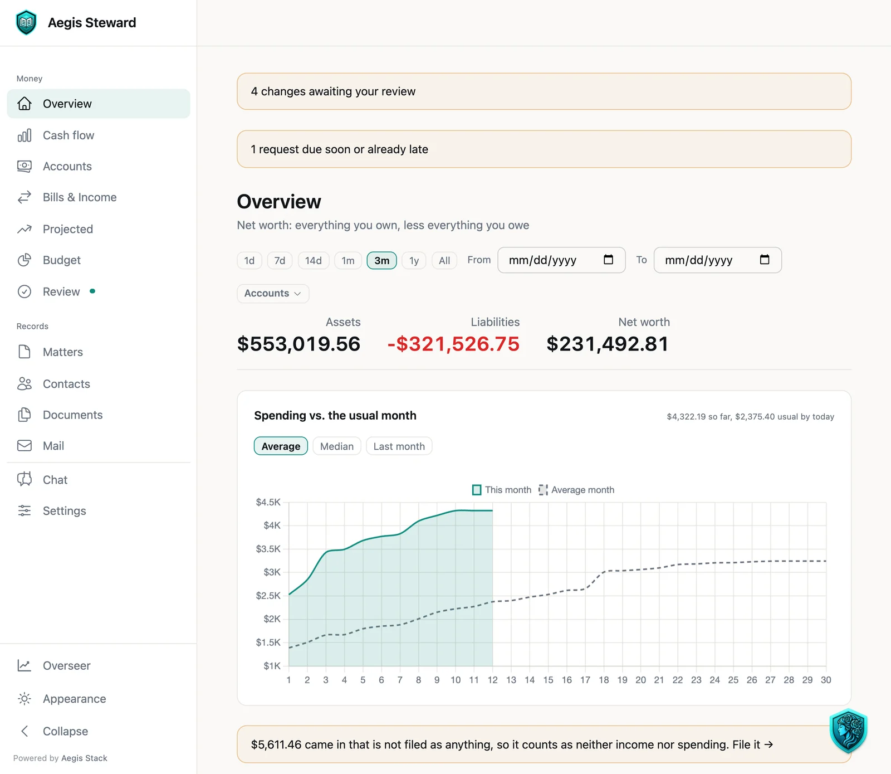
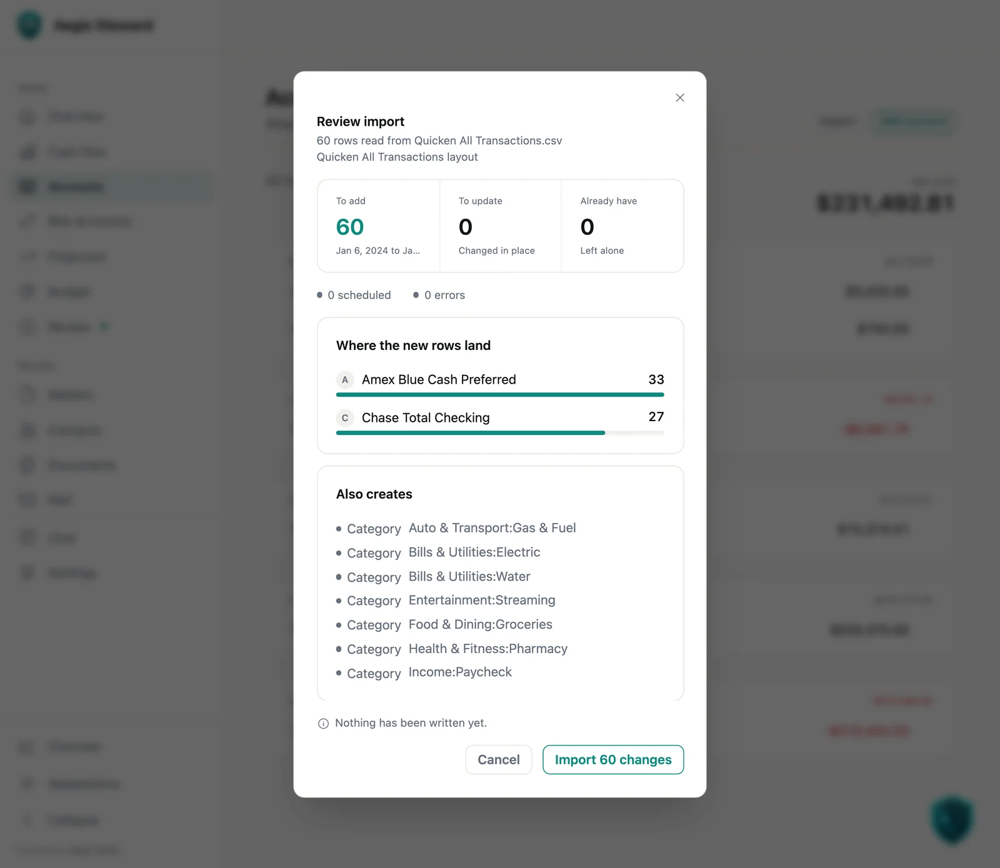
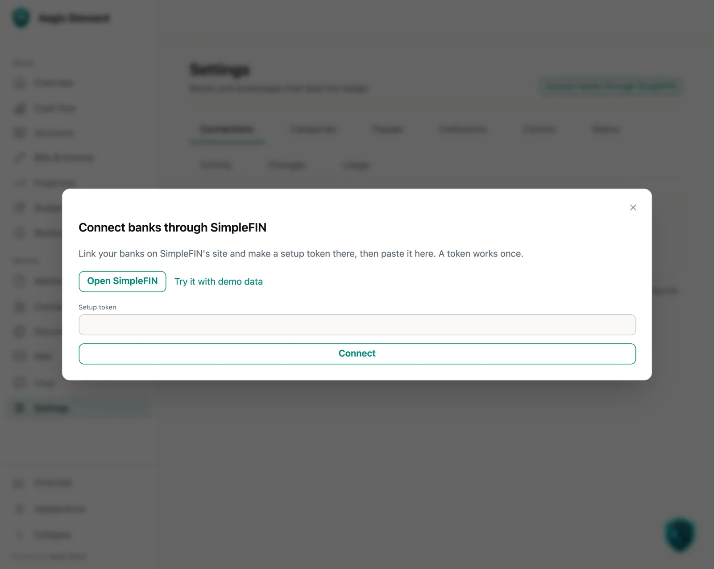
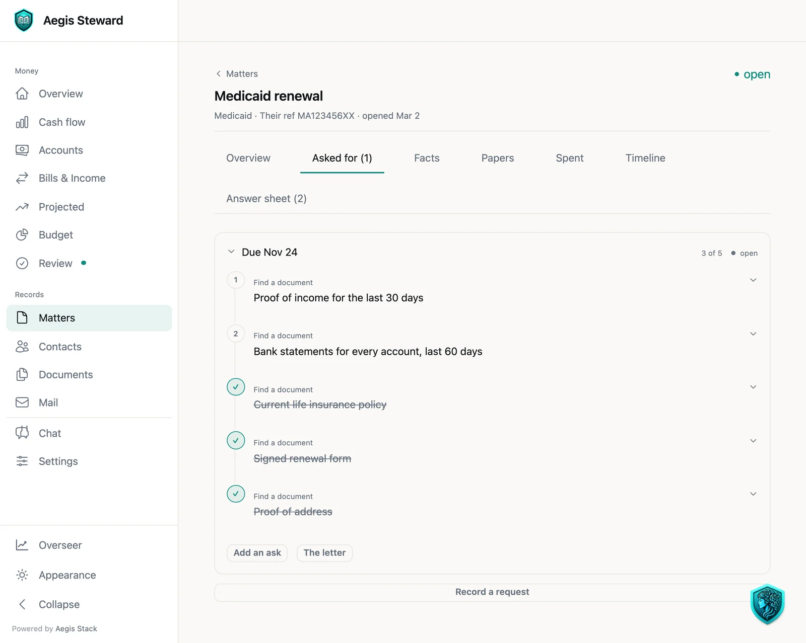
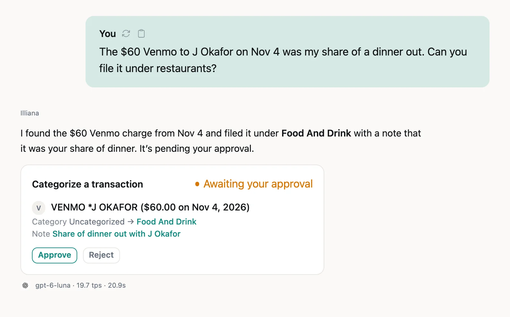
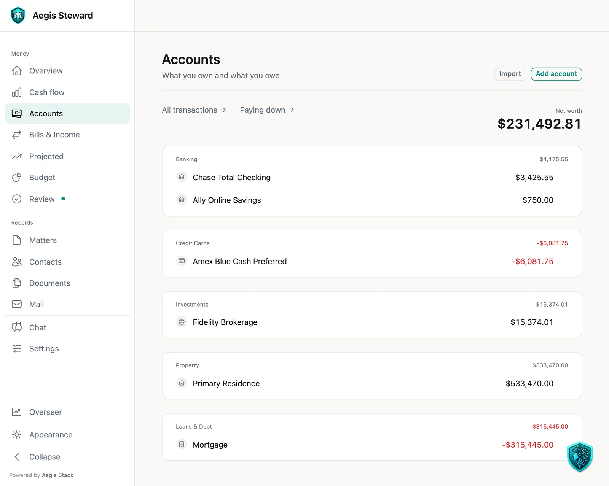
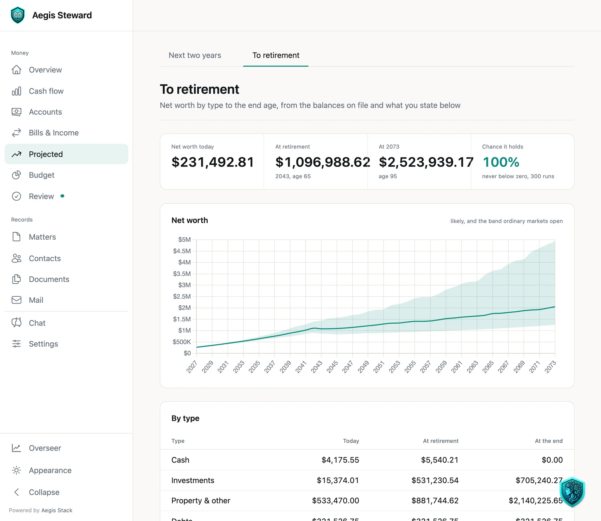
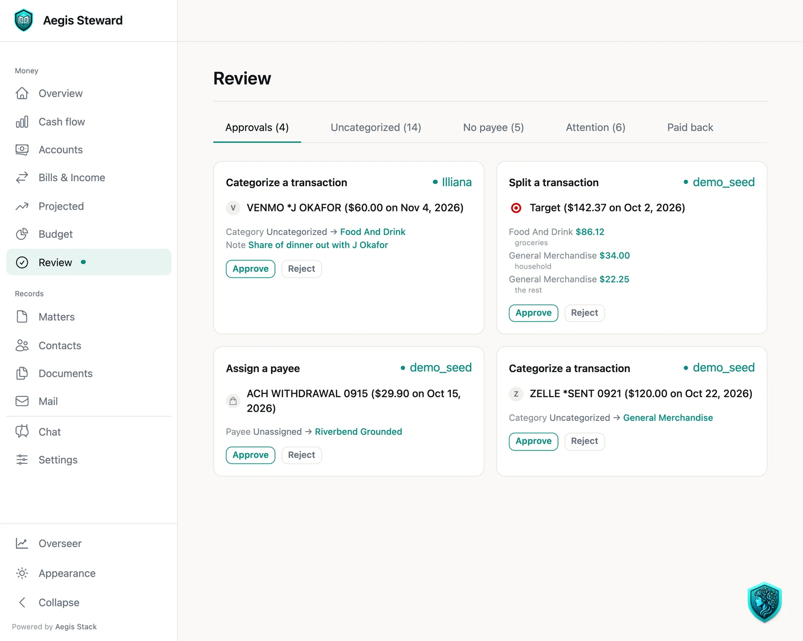

<p align="center">
  
</p>

<p align="center"><em>Your money, and the paperwork around it, on a server you own.</em></p>

<p align="center"></p>

Steward pulls in your accounts, shows where your money is and where it's headed, and keeps the letters, forms and deadlines that come with it in one place. Illiana, its assistant, answers questions about all of it and proposes changes, and nothing changes until you approve. It runs on your own machine or server, and your data stays there.

Built on [Aegis Stack](https://github.com/lbedner/aegis-stack).

<table>
<tr>
<td width="50%" valign="top">

### Connect
**Your accounts.** Link banks through SimpleFIN or Plaid and brokerages through SnapTrade, import statements (OFX, QFX, QIF, CSV, Excel) or another app's export, or add accounts by hand, including your house and car. On a server, connected accounts sync every six hours.

</td>
<td width="50%" valign="top">

### See
**Where it stands.** Net worth by type (with or without the house), cash flow and savings rate, spending against your usual month, recurring bills and income found automatically, and a Review queue for anything uncategorized or worth a look.

</td>
</tr>
<tr>
<td valign="top">

### Plan
**Where it's going.** A daily cash forecast up to two years out, budgets with goals and envelopes, a debt payoff plan (avalanche or snowball) with your debt-free date, and a retirement plan that runs 300 simulations to show a likely range and the chance it holds.

</td>
<td valign="top">

### Ask
**Illiana.** Ask about your money in plain words, from the chat page or the drawer on any page. She reads your ledger, accounts, bills, budget, plan and paperwork, and every change she suggests arrives as a card you approve, edit or reject.

</td>
</tr>
</table>

## Bring your data

Start with what you already have, then let it keep itself current.

<p align="center">
  
  
</p>

**Statement files and other apps.** Drop files, a whole folder or a `.zip` on Accounts, Import. Steward reads OFX, QFX, QIF, CSV and Excel, and recognizes Quicken (All Transactions and Mac register), Chase and American Express statements, and exports from Monarch, YNAB, Copilot and Empower, routing each row to its account by name. A layout it has never seen, you map once and it remembers.

**Review, then take it back if you need to.** Every import opens a review first: what it adds, what it updates, what you already have, and where the rows land. An account name it can't place becomes one question with a pick list. Nothing is written until you confirm. Afterwards it checks each account's balance against the file's, and any import can be undone from Settings, Activity. Re-importing an overlapping file is safe, because rows are matched by provider ID, then by content, then by account, date and amount.

**Connections that sync themselves.** On a server, connected accounts sync every six hours, and Settings, Activity lists every import and sync run.

| Integration | What it brings | What you need |
|---|---|---|
| [SimpleFIN Bridge](https://bridge.simplefin.org) | Bank and card accounts, balances, transactions including pending | A setup token from SimpleFIN, pasted under Settings, Connections. No keys on your side. |
| [Plaid](https://plaid.com) | Banks, cards, loans and investments: balances, transactions, holdings, trades, with real-time webhooks | Your own `PLAID_CLIENT_ID` and `PLAID_SECRET` in `.env` |
| [SnapTrade](https://snaptrade.com) | Brokerages: balances, positions, trades | `SNAPTRADE_CLIENT_ID` and `SNAPTRADE_CONSUMER_KEY` in `.env`. Access is by application. |
| Mail | Letters, receipts and attachments, pulled over IMAP every 30 minutes, or a Google Takeout `.mbox` or `.eml` uploaded on Documents | An IMAP app password, saved on the Secrets page |
| By hand | Your house, car, or anything no aggregator covers, with valuations over time | Nothing |

**History and live data meet.** Bring years of Quicken history first, then connect the bank. When a new connection reports an account your exports already feed, an exact match attaches on its own, and one that could be several waits for you to pick.

## Matters

Some money comes with paperwork attached: Medicaid renewals, insurance claims, taxes, an estate. A **matter** is one of those relationships, with the agency, your reference number and when the next letter is due.

- **Asked for:** each letter's demands, one ask per line, marked done, not applicable or waived
- **Papers:** the documents that answer each ask, filed on the matter
- **Facts:** figures about your money with where each one came from, kept, never overwritten
- **Spent:** the transactions that belong to it
- **Timeline:** calls, mailings, visits and notes
- **Answer sheet:** everything they asked for and what answers it, ready to print

Deadlines show up in Review before they're late. Steward can also read your mail over IMAP, file letters and attachments as documents, and link them to the matters they belong to.

<p align="center"></p>

## Nothing changes without you

Every change Illiana proposes, from categorizing a charge to filing a document on a matter, is a card, right in the conversation and in your Review queue. Approve one at a time or a batch at once, veto single rows, or edit a card before it applies. Approval is the only way a change happens.

<p align="center"></p>

## Your data stays yours

- **Encrypted at rest:** provider tokens, account numbers and saved sign-ins are encrypted with AES-256-GCM. Outside development, Steward won't start without an encryption key.
- **Locked by default:** password sign-in, rate limits and lockout, no public registration. Every page sits behind sign-in.
- **What leaves the server:** what you connect, which is your AI provider, your finance providers and your mail server. Besides those, Steward fetches merchant icons from Google's favicon service and refreshes its AI model price list. No analytics, no error tracking, no update checks.
- **Take it with you:** Export everything, on Settings, Activity, writes the whole ledger (accounts, rules, budgets, history) to one archive, and `finance restore` brings it back on another server.
- **Backups:** a nightly backup on the server, plus an optional encrypted off-site copy to S3 or DigitalOcean Spaces.

<p align="center">
  
  
  
</p>

## Try it

```bash
git clone https://github.com/aegis-stack/aegis-steward
cd aegis-steward
cp .env.example .env
make serve
```

`make serve` stays in the foreground. In a second terminal:

```bash
make cli ARGS="auth create-user --email you@example.com"
make cli ARGS="finance seed-demo"   # six accounts, eight months of sample data
```

Set `ADMIN_USER_EMAILS=["you@example.com"]` in `.env`, then open `http://localhost:<port>`, where the port is `WEBSERVER_HOST_PORT` in `.env.ports`. Illiana needs a model: the example config uses a local Ollama with `llama3.2:3b`, or set `AI_PROVIDER` to the provider you use.

To bring in real accounts, see [Bring your data](#bring-your-data).

## Run it on your own server

Steward deploys from GitHub Actions: open **Actions, Deploy, Run workflow**. Set `DEPLOY_SSH_KEY`, `DEPLOY_HOST` and `DEPLOY_CONFIG` as repository secrets. Put the server's environment in a `DEPLOY_ENV` secret, starting from `.env.deploy.example`: it needs `DOMAIN`, `ACME_EMAIL`, `REDIS_PASSWORD`, `ENCRYPTION_KEY` and `APP_ENV=prod`. `scripts/server-setup.sh` prepares a fresh Ubuntu, Debian or Fedora box. HTTPS comes from Traefik.

## License

[MIT](LICENSE)
